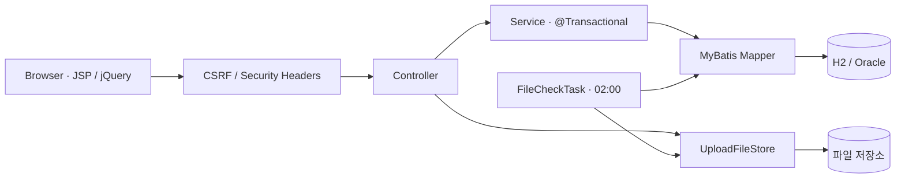
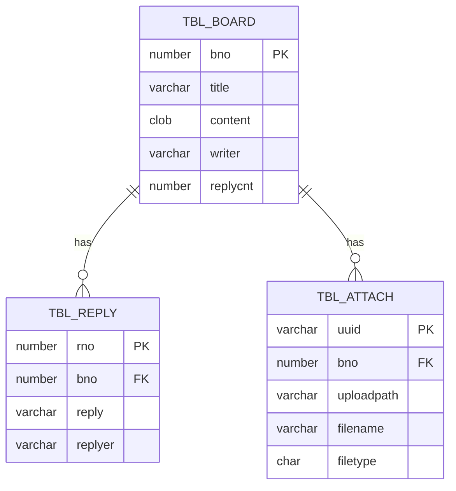

# 구조와 요청 흐름

## MVC 계층

Spring 루트 컨텍스트는 DB·서비스·파일 저장소를 구성하고, DispatcherServlet의 자식 컨텍스트는 MVC 컨트롤러와 ViewResolver를 구성합니다. Jackson 3이 댓글·첨부 API의 JSON을 처리합니다.

## 데이터 관계

게시글·댓글 번호는 시퀀스로 생성합니다. 댓글 수는 게시글에 저장하며, 댓글 생성·삭제와 같은 트랜잭션으로 갱신합니다. Boolean 이미지 여부는 CHAR(1)의 0/1과 타입핸들러로 변환합니다.

## 첨부파일 수명

1. 업로드 요청에서 크기·이름·형식을 검사하고 UUID 파일을 저장합니다.
2. 서버가 발급한 경로·이름·UUID·이미지 여부를 업로드 세션에 기록합니다.
3. 게시글 등록·수정에서 같은 세션의 미저장 파일과 기존 DB 첨부만 허용합니다.
4. DB 커밋 이후 미저장 상태를 해제하고 수정에서 제외한 파일을 삭제합니다.
5. 업로드 취소는 해당 세션의 미저장 파일만 삭제합니다.
6. 예약 작업은 오늘·어제를 제외한 과거 날짜 폴더 전체에서 수정 시각이 48시간을 넘긴 파일을 확인하고, DB에 연결되지 않은 UUID 관리 파일만 정리합니다. 삭제 직전에 DB를 다시 확인하며 DB 확인에 실패하면 삭제를 중단합니다.

저장 경로는 `YYYY/MM/DD/UUID_파일명`, 이미지 섬네일은 `YYYY/MM/DD/s_UUID_파일명`입니다. DB의 기존 역슬래시 경로는 조회할 때 정규화하고 파일 연결 여부는 UUID로 확인합니다. 잘못된 날짜·일반 파일명·경로 이동·심볼릭 링크는 접근과 정리 모두에서 거절합니다. 신규 업로드 정보는 세션에서 최대 48시간 동안 유효하며, 게시글당 최대 10개 첨부를 서버의 원본 정보와 대조합니다.

파일은 5 MiB 미만이어야 합니다. 이미지 확장자는 실제 PNG/JPEG/GIF 디코더와 대조하고, 디코딩 전에 2,000만 픽셀 및 가로·세로 각각 12,000 픽셀 상한을 확인합니다. 섬네일은 직접 만든 PNG를 다시 읽어 검증합니다. 일반 문서는 다운로드 응답으로만 제공하며 UTF-8 텍스트, PDF 서명, Office ZIP 구조와 매크로 포함 여부를 검사합니다.

파일 시스템은 DB 트랜잭션에 참여하지 않습니다. 커밋 후 디스크 삭제가 실패하면 남은 파일을 이후 예약 작업이 다시 정리합니다. 저장·정리에 사용하는 Java 잠금은 한 JVM 안에서 공유하므로 다중 인스턴스 배포에는 별도 분산 조정이 필요합니다.

## 주요 API

경로는 애플리케이션 컨텍스트 `/spring-board` 아래입니다.

| 요청 | 용도 |
| --- | --- |
| `GET /board/list` | 목록·검색·페이징 |
| `GET/POST /board/register` | 등록 화면·저장 |
| `GET /board/get?bno=...` | 상세 |
| `GET/POST /board/modify` | 수정 화면·저장 |
| `POST /board/remove` | 게시글·댓글·첨부 삭제 |
| `GET /board/getAttachList?bno=...` | 첨부 목록 |
| `POST /replies/new` | 댓글 등록 JSON |
| `GET /replies/pages/{bno}/{page}` | 댓글 목록 JSON |
| `GET/PUT/DELETE /replies/{rno}` | 댓글 조회·수정·삭제 |
| `POST /uploadAjaxAction` | multipart 업로드 |
| `GET /display?fileName=...` | 검증된 PNG 이미지 |
| `GET /download?fileName=...` | 파일 다운로드 |
| `POST /deleteFile` | 미저장 업로드 취소 |

변경 요청에는 `X-CSRF-Token` 헤더 또는 `_csrf` 폼 값이 필요합니다. 페이지의 `csrf-token` 메타 값은 세션 토큰이며, 프런트엔드 공통 Ajax 설정이 헤더로 전송합니다.

목록 기본 크기는 10개, 허용 최대 크기는 100개입니다. 제목 200자, 본문 20,000자, 작성자 50자, 댓글 1,000자까지 받습니다. 존재하지 않는 대상은 404, 잘못된 입력은 400, CSRF·업로드 소유권 위반은 403으로 응답합니다.
